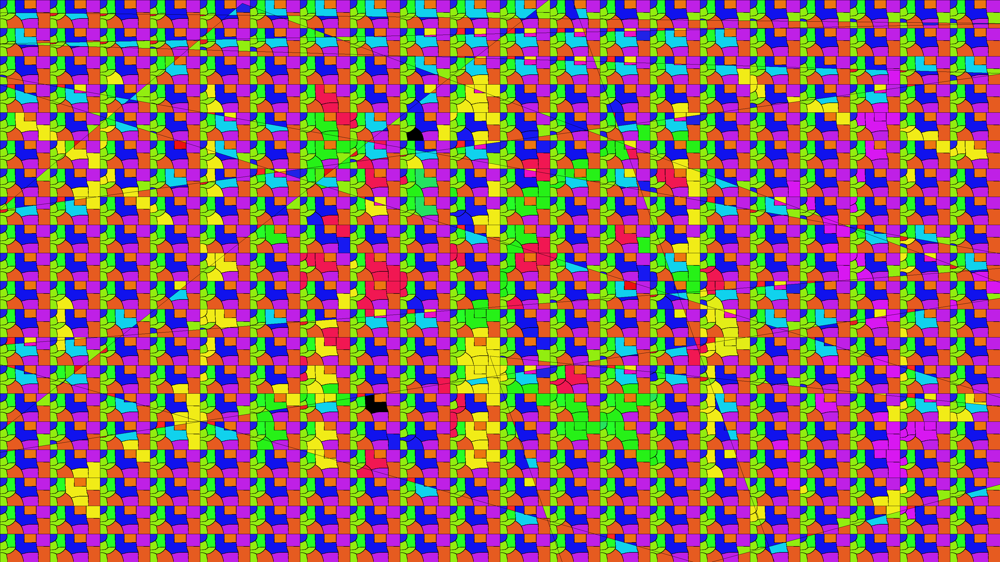

# colorist

Fills every white polygon of `mask.png` with the color that occurs most often
inside it in `color_mask.png`. C++17, OpenCV 4.14 (`core`, `imgproc`, `imgcodecs`).

- Foreground: mask value `> 127`; polygons are 4-connected. Everything else is black.
- Ties between equally frequent colors go to the smallest packed value `B | G<<8 | R<<16`.
- Output is an 8-bit BGR PNG.



Median time per frame (`bench.py`; image I/O excluded; `rle` output identical to the baseline's):

| Machine | Algorithm | Threads | Reuse | Fresh |
|---|---|---|---|---|
| Windows i5-11400H, Clang 23 | `base_spaghetti` | 6 | 37.71 ms | 37.44 ms |
| Windows i5-11400H, Clang 23 | `rle` | 6 | **4.32 ms** | **5.81 ms** |
| Raspberry Pi 5, GCC 14.2 | `base_spaghetti` | 2 | 68.79 ms | 68.88 ms |
| Raspberry Pi 5, GCC 14.2 | `rle` | 2 | **10.85 ms** | **11.92 ms** |

100 runs each, except Raspberry Pi `base_spaghetti` (30 runs). `reuse` keeps one algorithm
object; `fresh` creates a new one per run, so its working buffers are allocated again.

The task's input images are not included; the commands below expect them in `test_task_CV_CPP/`.

## Build

Windows x64 (downloads portable CMake, LLVM-MinGW, Ninja and builds OpenCV locally on first run):

```powershell
powershell -NoProfile -ExecutionPolicy Bypass -File .\build.ps1             # release
powershell -NoProfile -ExecutionPolicy Bypass -File .\build.ps1 -AlgoTiming # + per-stage timing
```

Linux / Raspberry Pi OS (needs a C++17 compiler, `make`, `curl`; see [RPI.md](RPI.md)):

```sh
sh ./build.sh               # release
sh ./build.sh --algo-timing # + per-stage timing
```

Everything stays inside the project (`.tools/`, `.deps/`, `build/`). The build
uses AVX2 on x86 when the CPU supports it, NEON on ARM.

## Run

```sh
./build/colorist --mask test_task_CV_CPP/mask.png --color_mask test_task_CV_CPP/color_mask.png \
                 --output result.png --algo-type rle --parallel --threads 2
```

| Option | Meaning |
|---|---|
| `--algo-type rle` | The fast implementation described below. |
| `--algo-type base_spaghetti` (default), `base_sauf`, `base_bbdt` | Baseline: OpenCV `connectedComponents` + histogram pass + coloring pass. |
| `--parallel [--threads N]` | Use N threads (OpenCV's default count without `--threads`). Without `--parallel`: 1 thread. |
| `--warmup W --runs R` | Untimed warm-up runs, then R timed runs; the mean is printed. |
| `--lifecycle reuse\|fresh` | `reuse` (default): one algorithm object for all runs. `fresh`: a new object per run; its construction buffers and destruction are timed. |
| `--metrics file.json` | Save every timed sample. |

Timing covers only the algorithm: reading/decoding the PNGs, allocating the
output image and writing the result are excluded, as the task requires.

## Algorithm (`sources/RleAlgo.h`)

One pass over the image, working on runs of foreground pixels instead of pixels:

1. **Stripes.** The image is split into horizontal stripes, one per thread.
2. **Runs per row.** A SIMD pass over the mask row finds all foreground runs `[x0, x1]`.
3. **Connectivity.** Each run is joined with the overlapping runs of the previous row
   using union-find (union by size, path halving).
4. **Histograms.** Each run is split into stretches of equal color (SIMD compare);
   each stretch adds its length to the component's histogram. Colors are mapped
   to small palette ids through a cache, so histograms are short arrays.
5. **Early finish.** When a row does not continue a component, the component is
   complete: its color is chosen and its histogram slot is reused.
6. **Row painting.** As soon as every component touching a row is complete, the row
   is written: zeroed (black background), then its colored runs filled. Output is
   written once, in row order, shortly behind the scan.
7. **Stripe edges.** Components touching an internal stripe edge are merged across
   stripes after the parallel part (a small union-find over all stripes, histograms
   merged), then painted.

Memory traffic per 3840×2160 frame is ~33 MB of input (8 MB mask + 25 MB BGR colors)
and 25 MB of output, each read or written once.

## Settings and why

| Setting | Value | Reason |
|---|---|---|
| Threads, Raspberry Pi 5 | **2** | Measured best. One thread is compute-bound; beyond two, the Pi's usable memory bandwidth drops with every extra stream (see memory floor below). |
| Threads, Windows (i5-11400H, 6 cores) | **6** | One per physical core; 5–10 threads perform the same. |
| Color mask decoded as BGR | `IMREAD_COLOR` | Alpha is 255 on every pixel of the input, so it never decides a color; reading 3 instead of 4 bytes per pixel cuts input traffic by 8 MB. Colors differing only in alpha count as one color. |
| Output | `CV_8UC3` BGR | No alpha needed; 25% fewer bytes written. |
| Row painting via `memset` | — | On ARM, glibc zeroes whole rows with `DC ZVA`: output cache lines are allocated without being read from memory first. |
| Build | Release, `-O3` | AVX2 on x86, NEON on ARM. |

Thread scaling, `rle`, reuse lifecycle (mean ms per frame):

| Threads | 1 | 2 | 3 | 4 | 6 | 8 | 12 |
|---|---|---|---|---|---|---|---|
| Raspberry Pi 5 | 19.41 | **10.85** | 11.08 | 11.79 | — | — | — |
| Windows i5-11400H | 11.67 | 6.27 | 4.78 | 4.50 | **4.07** | 4.36 | 4.66 |

### Memory floor

`bench_fill.sh` runs the frame's unavoidable memory traffic with no labeling at all:
read every mask and BGR byte (33 MB), zero each output row and overwrite its foreground
runs (25 MB), in the same row stripes as `rle`. Median ms per frame:

| Threads | 1 | 2 | 3 | 4 | 6 |
|---|---|---|---|---|---|
| Raspberry Pi 5: floor | **6.87** (8.5 GB/s) | 7.93 (7.3 GB/s) | 8.69 (6.7 GB/s) | 9.12 (6.4 GB/s) | — |
| Raspberry Pi 5: `rle` | 19.41 | **10.85** | 11.08 | 11.79 | — |
| Windows i5-11400H: floor | 8.29 | 4.35 | — | 3.83 | **3.86** |
| Windows i5-11400H: `rle` | 11.67 | 6.27 | 4.78 | 4.50 | **4.07** |

- On the Pi a single core already saturates DRAM, and more concurrent streams lower
  the usable bandwidth: the floor itself rises with every thread. Writes are the
  larger part (25 MB take 4.2 ms, 33 MB of reads 2.3 ms).
- At 2 threads `rle` reads about as much from DRAM as the floor kernel (41 vs 39 MB per
  frame, from `L3 refill` counters); the remaining gap is computation: ~107M versus
  ~17M instructions per frame. One thread is compute-bound (2.8× the floor); a second
  thread halves the computation at a cost of ~1 ms of bandwidth, which makes 2 threads
  the best setting (1.37× the 2-thread floor).
- On Windows `rle` at 6 threads runs within ~5% of the floor (4.07 vs 3.86 ms).

## Benchmark and verification

```sh
# Reference image from the baseline, then benchmark with exact output comparison
./build/colorist --mask test_task_CV_CPP/mask.png --color_mask test_task_CV_CPP/color_mask.png \
                 --output build/reference.png --algo-type base_spaghetti
python bench.py --mask test_task_CV_CPP/mask.png --color-mask test_task_CV_CPP/color_mask.png \
                --algos base_spaghetti rle --modes parallel --threads 6 --warmup 10 --runs 100 \
                --reference build/reference.png
```

`bench.py` runs configurations in shuffled rounds and reports median, mean, P95,
min/max and a PASS/FAIL pixel comparison; `--reference` needs Pillow
(`pip install -r requirements-bench.txt`). Reports go to `build/bench/`.

Tests (`python -m unittest discover -s tests`) compare every algorithm against
an independent flood-fill implementation on generated images, including
single-pixel and very wide images, thread counts above the image height and
histogram/union-find edge cases. `tests/test_rle_reuse.cpp` checks repeated
calls on one object and that nothing is written outside the output view.

Linux profiling: `bash ./profile.sh [threads] [runs]` (perf record + annotated
hotspots), `bash ./perf_scan.sh` (per-frame hardware counters for 1–4 threads) and
`bash ./bench_fill.sh [runs] [kernels] [threads]` (memory floor; source in `benchmarks/fill/`).
